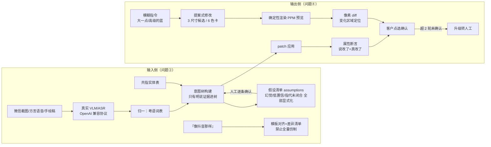

# sprout-visual-loop

> **视觉反馈闭环**（问题②+④）：输入侧"多模态脏输入 → 无幻觉结构化需求"；输出侧"提案式修改 + 自动验收断言"。
>
> 客户用视觉方式表达需求（截图/方言语音/手绘稿），也用视觉方式验收结果（"logo 大一点""高级点的蓝"）——同一个闭环的两端。


## 对应岗位难题

末龙科技 AI 应用工程师岗·三大技术难题之**问题②+④**。输入侧的命门是**幻觉补全**（客户没提的，模型按"常见 APP 该有的样子"悄悄加上）；输出侧的天花板是**主观验收无法形式化**——正确目标不是消灭人工确认，而是压缩确认的往返次数与单次成本。

## 架构



## 快速开始

```bash
# 输入侧：脏输入 → 意图树 + 假设清单（幻觉被捕获进 assumptions，暗幻觉=0）
python3 -m visual_loop.cli intake --inputs examples/inputs.json

# 参考表达 → 模板 + 差异清单（不做全量仿制）
python3 -m visual_loop.cli align --ref "做个像抖音那样的"

# 输出侧：模糊指令 → 多候选 + 预览截图
python3 -m visual_loop.cli propose --config examples/site.json --kind resize --target logo --out-dir previews
python3 -m visual_loop.cli propose --config examples/site.json --kind color --target banner --out-dir previews

# 属性断言 + 像素 diff（"说改了但没改"必被抓住）
python3 -m visual_loop.cli verify --declared examples/declared.json --before examples/site.json --after examples/site2.json
python3 -m visual_loop.cli diff --before examples/site.json --after examples/site2.json
```

## 验证

```bash
python3 -m unittest discover -s tests -v   # 29 项全绿
```

同一套测试在缺陷基线上 **15 项失败**（docs/06）：暗幻觉混入需求树、手绘稿直接采用、指代悬空、修改不验证、单点拍板、审美死胡同无限打转。

深入自主研究（61 次真实 VLM 调用，模型能力上限实证）：[docs/research/deep-dive-20261014.md](docs/research/deep-dive-20261014.md)——实测小模型自报置信坍缩/采样非确定性/畸形 JSON，及其工程对策。

## 目录结构

```
visual_loop/
  intent_tree.py    # 意图树：明说证据才进树（source+confidence）
  assumptions.py    # 假设清单机制（反幻觉核心）+ 暗幻觉计数
  coref.py          # 共指实体表：『那个』的指代链
  normalize.py      # 粤语/转写噪音归一
  align.py          # 参考图对齐：最近模板 + 差异清单
  vlm.py           # 真实 VLM 客户端（容错 JSON 解析 + describe_stable 自一致置信）
  asr.py           # 真实 ASR 客户端（OpenAI 兼容 /audio/transcriptions）
  proposals.py      # 提案式修改：3 尺寸候选 / 6 色卡 + 预览
  render.py         # 确定性渲染器：配置 → PPM 截图
  pixel_diff.py     # 像素 diff：变化率 + 区域 bbox
  assertions.py     # 属性断言：声明的改动逐条机检
  rounds.py         # 往返计数：超 2 轮未确认升级转人工
  api.py / cli.py
tests/              # 29 项回归（输入侧 12 + 输出侧 6 + 研究 7 + live env-gated 4）
examples/           # CLI 演示样例
docs/
```

## 工程过程

问题报告见 [Issue #1](https://github.com/kaijie0074-art/sprout-visual-loop/issues/1)，修复走 [PR #2](https://github.com/kaijie0074-art/sprout-visual-loop/pull/2)（评审/采纳/验收），发布见 [Releases](https://github.com/kaijie0074-art/sprout-visual-loop/releases)。

## 声明

**说明**：针对末龙科技 AI 应用工程师岗三大技术难题之问题②的工程化实现（2026-10）。VLM/ASR 为真实 API（OpenAI 兼容协议，默认智谱，可切换任意兼容服务）；图像为代码生成的 PPM 文本位图（零依赖的截图管线最小实现）；技术路线源自公开调研与业务链路推演。
